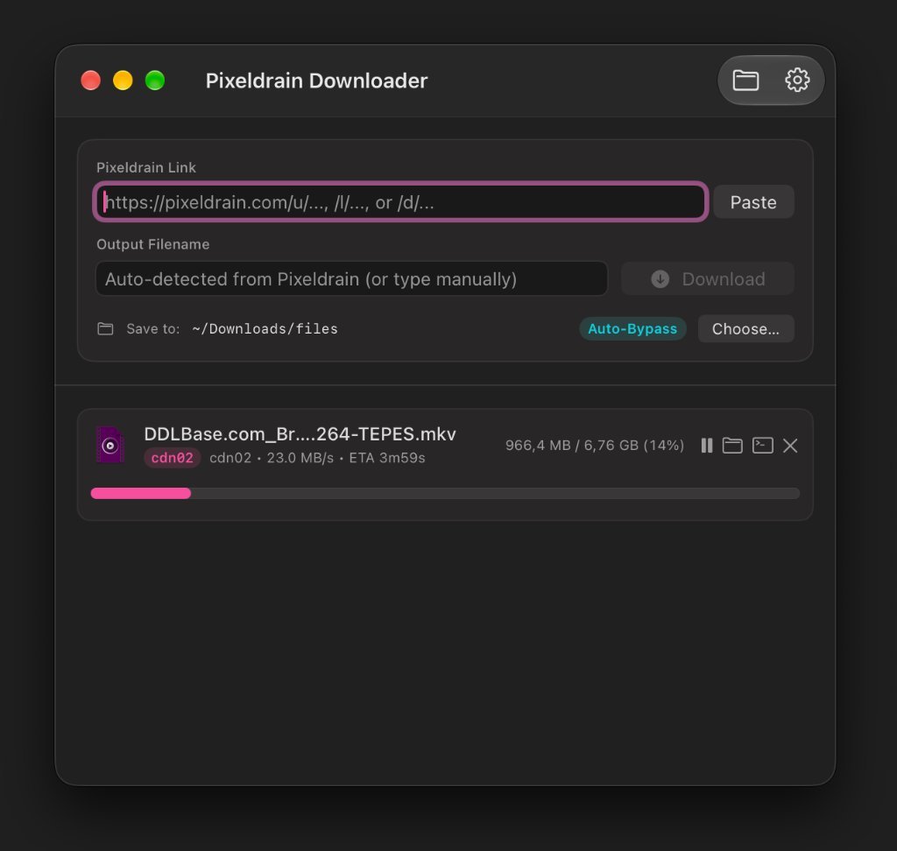

# Pixeldrain Downloader for macOS

A native SwiftUI macOS app combining automatic Pixeldrain bypass proxy routing (`pixeldrain-bypass.cybar.to`) with the CDN mirror-cycling `aria2c` download engine from [`pixeldrain.sh`](pixeldrain.sh).



## Features

- **Paste, drag-and-drop, or auto-detect from clipboard** any normal Pixeldrain link (`/u/ID`, `/api/file/ID`, `/l/ID` albums/galleries, or `/d/ID` directories across `pixeldrain.com`, `.net`, `.dev`, `pixeldra.in`)
- **Automatic proper filename & size resolution** via `/api/file/{id}/info`, `/api/list/{id}`, `window.initial_node` parsing, and `Content-Disposition` headers
- **Automatic bypass proxy routing + CDN fallback** using `pixeldrain-bypass.cybar.to/api/proxy.json` (cached 24h) followed by `cdn01`–`cdn48` mirrors via `aria2c` (`-x8 -s8 -k1M --stream-piece-selector=inorder --continue=true`)
- **Album & directory support**: download all individual files with their original names into a subfolder, or download as a ZIP archive
- **Slow-mirror detection & switching** (switches automatically below `3.0 MB/s` after a `20s` warm-up, configurable in Settings `⌘,`)
- **Live progress bar, speed, ETA, Pause/Resume, Reveal in Finder, and per-download `aria2c` log popover**
- **Standalone `.app` bundle** with `aria2c` and its libraries bundled inside `Contents/Helpers` & `Contents/Frameworks`

## Install (macOS 14+ Apple Silicon)

1. Download `Pixeldrain-Downloader-macOS-arm64.zip` from [Releases](../../releases).
2. Unzip and move `Pixeldrain Downloader.app` to `/Applications/`.
3. If macOS Gatekeeper blocks the unsigned/ad-hoc app on first open, right-click the app → **Open** (or run `xattr -dr com.apple.quarantine "/Applications/Pixeldrain Downloader.app"`).

## Build from Source

Requires Xcode, [XcodeGen](https://github.com/yonaskolb/XcodeGen), and `aria2`:

```bash
brew install xcodegen aria2
./scripts/build_app.sh
cp -R "dist/Pixeldrain Downloader.app" /Applications/
```

## Run Tests

```bash
xcodegen generate
xcodebuild test -project PixeldrainDownloader.xcodeproj -scheme PixeldrainDownloader -derivedDataPath .deriveddata -destination 'platform=macOS'
```
